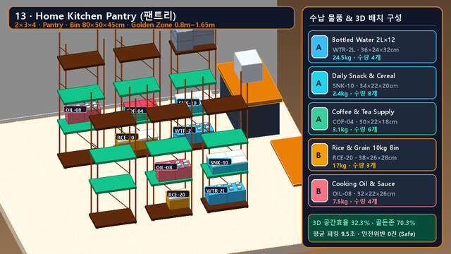
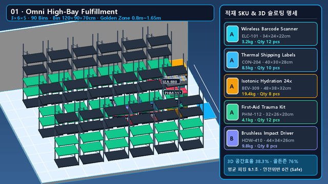

# CubiSlot 3D — 3D Warehouse & Living Space Slotting Digital Twin (`#BuildHybridAI 2026`)

> **Google for Developers `#BuildHybridAI 2026` Challenge · Web / Chrome Track**  
> Open-Source 3D Warehouse Slotting Optimization & Everyday Home Storage Digital Twin powered by **Firebase AI Logic (`firebase/ai`)** Hybrid Inference (**On-Device Chrome Gemini Nano** + **Cloud Gemini Fallback**).





---

## ✨ Key Features

1. **3D Warehouse & Everyday Space Slotting Engine (`src/engine/slottingEngine.ts`)**
   - **Z-Axis Golden Zone Ergonomics (`0.80m – 1.65m`)**: Aligns high-frequency Class-A SKUs to waist-to-shoulder elevation to minimize vertical lift fatigue and cycle time.
   - **3D Bin Packing with Best-Fit 6-Axis Rotation & Multi-SKU Co-Packing**: Eliminates cubic void waste (*honeycombing*) while enforcing **70% physical bottom-support**, **fragile top-stack protection**, and **heavy-on-light crush prevention (`≤ 1.45×` weight ratio)**.
   - **NIOSH Structural & Rack Safety Guard**: Anchors heavy cargo (`> 16 kg`, or `> 10 kg` in Max-Safety mode) to lower levels (`Z1–Z2`), achieving **0 safety violations**.
   - **3D Kinematics & Nearest-Neighbor TSP Pick Wave**: Models both **Reach-Truck** sequential lift/travel and **AS/RS Dual-Mast Crane Chebyshev (`max(dx/vx, dz/vz)`)** simultaneous motion with depot-rooted TSP routing.
   - **4 One-Click 3D Optimization Presets**: `Balanced (균형)`, `Fast Pick (빠른 동선)`, `Max Density (공간 압축)`, `Max Safety (안전 최우선)`.

2. **24 Ready-to-Use Pro & Everyday Space Templates with Bespoke 3D Previews (`src/data/warehouseTemplates.ts`, `public/templates/`)**
   - **12 Professional WMS / Logistics Templates**: Omni High-Bay, AS/RS Cube, Cold-Chain Hub, Heavy Cross-Dock, Pharma GDP Vault, Fashion Mezzanine, Auto Parts, 3PL Cross-Aisle with Pillars, Beverage Depot, ESD Clean Rack, Q-Commerce Dark Store, Goods-to-Person Shuttle.
   - **12 Everyday Home & Small-Business Templates**: Home Kitchen Pantry (팬트리), Walk-In Closet (드레스룸), Deep Fridge & Freezer (냉장고), Garage & DIY Tool Rack (차고/공구), Camping Gear (캠핑장비), Studio Apartment Wall (원룸 수납벽), Smart Store Packing Room (스마트스토어), Study & Hobby Shelf (서재/취미), Laundry & Utility Room (다용도실), Cafe Stockroom (카페 창고), Office Supply Archive (사무실 비품), Moving & Self-Storage (이삿짐).

3. **Everyday Life Home Dashboard (`src/components/EverydayHomeView.tsx`)**
   - Dedicated approachable home mode with visual template cards, SKU content chips, plain-language KPIs, and a **10-Second Custom Room / Shelf Builder**.

4. **Interactive 3D Digital Twin Studio (`src/components/Warehouse3DViewport.tsx`, `src/utils/threeContentBuilder.ts`)**
   - **Rich 3D Content Models & 512×512 Procedural Textures**: Displays actual SKU names, codes, weights, ABC badges, barcodes, protruding bottle caps, wooden pallet skids, container snap lids, and fragile corner guards in 3D.
   - **Whole-Template & Single-Rack 3D Drag-Move**: Drag the **entire template layout** (or individual rack columns and 3D furniture) live at 60fps across a fixed 1m floor grid without parallax jumps, plus 1-click **90° Whole-Template Rotation**, **Span+/Span- Spacing Scaling**, and **Center Alignment**.
   - **3D Space Interior & Furniture Builder (`src/components/InteriorStudioModal.tsx`)**: Place, drag, rotate, scale, and recolor 12 types of 3D furniture, appliances, doors, and windows (`Desk`, `Island Counter`, `Fridge`, `Washer`, `Standing Mirror`, `Sofa`, `Window`, `Door`, `Plant`, `Carpet`, `Tool Cabinet`, `Reach Truck`) + 4 room wall styles.
   - **3D Background & Lighting Studio (`src/components/Scene3DBackgroundModal.tsx`)**: 12 lighting/backdrop presets (defaulting to **Bright Daylight Studio** with HemisphereLight, dual directional fill lights, ACES Filmic exposure, and zero dark fog) + custom color pickers and floor materials.
   - **Live 3D Hover HUD Card, Aisle Floor Markers (`A1..An`), and Z-Level Height Ruler Tower (`Z1..Zn`)**.

5. **2D Free-Canvas Map Editor & 2D CAD Blueprint Exporter (`.DXF` / `.SVG`)**
   - **2D Free Canvas (`src/components/MapEditorModal.tsx`)**: Drag-and-drop racks, marquee multi-select, right-click context actions, interactive floor resize handles, pillars/obstacles, and JSON import/export.
   - **AutoCAD R12 `.DXF` & `.SVG` Blueprint Generator (`src/utils/cadExporter.ts`)**: 1:1 metric plan view + front Z-elevation view.

6. **Firebase AI Logic Hybrid Co-Pilot (`src/services/hybridAi.ts`, `src/services/firebaseClient.ts`)**
   - Uses official **`firebase/ai`** SDK (`InferenceMode.PREFER_ON_DEVICE`, `ONLY_ON_DEVICE`, `PREFER_IN_CLOUD`, `ONLY_IN_CLOUD`) with Chrome built-in **Gemini Nano Prompt API** detection, **Cloud Gemini** fallback, **Firebase App Check** (reCAPTCHA v3 / Debug Token), **Firebase Remote Config**, and **Cloud Firestore** run snapshots.

7. **Full Korean / English (`한국어 / EN`) Localization & 18 Global Keyboard Shortcuts**
   - Instant `한국어 ↔ EN` language toggle (`L`) + `Easy Mode ↔ Pro Terms` toggle + 24 UI Design Themes (`src/data/designThemes.ts`).

---

## ⌨️ Keyboard Shortcuts

| Key | Action |
| --- | --- |
| `1` / `2` / `3` | Switch 3D Camera (`1`: 3D Isometric, `2`: 2D Top Plan, `3`: Z-Elevation) |
| `R` | Reset 3D Camera Framing |
| `Space` | Toggle `Before: 2D Baseline` ↔ `After: 3D Optimized` |
| `M` | Toggle 3D Mouse Drag-Move Mode (Whole Template / Single Rack / Furniture) |
| `I` | Open 3D Space Interior & Furniture Studio |
| `B` | Open 3D Background & Lighting Studio |
| `E` | Open 2D Free-Canvas Map Editor |
| `T` | Open 24-Template Gallery |
| `C` | Open 2D CAD (`.DXF` / `.SVG`) Blueprint Exporter |
| `G` / `H` | `G`: Golden Zone View · `H`: 3D Pick Frequency Heatmap |
| `W` / `L` | `W`: Everyday Home ↔ 3D Studio · `L`: Korean ↔ English |
| `←` `↑` `↓` `→` | Move Selected 3D Furniture Prop, Rack Column, or Whole Template |
| `[` / `]` | Rotate Selected 3D Interior Furniture Prop by 45° |
| `+` / `Delete` | `+`: Add +1 Z-Level Above Bin · `Delete`: Remove Selected Bin or Prop |
| `?` / `K` | Open Keyboard Shortcuts Guide |

---

## 🚀 Quick Start

```bash
# 1. Install dependencies
npm install

# 2. (Optional) Configure Firebase AI Logic & App Check
cp .env.example .env

# 3. Start development server
npm run dev

# 4. Type-check & build for production
npm run typecheck
npm run build
```

---

## 📄 Open-Source License

Licensed under the **Apache License, Version 2.0** — see [LICENSE](LICENSE).
